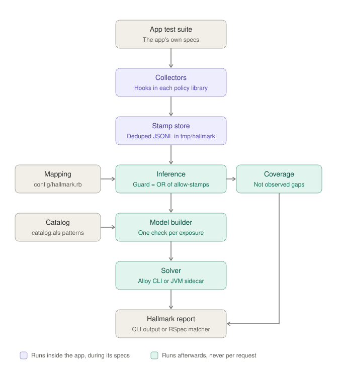

# Hallmark for Ruby

Hallmark checks a Ruby app's role-based authorization against a catalog of
access control patterns written in [Alloy](https://alloytools.org), and
reports every declared action that lets someone read or change data no
pattern allows. Each report comes with a concrete counterexample: who,
holding which roles, can do what to whose record.

A hallmark is the mark an assay office strikes to certify what an alloy is
made of. Here the assay is a bounded search, and the hallmark is its report:
which pattern each action matches, and where one matches none. Where nothing
is found, the report says "no counterexample within scope N", never "safe".

## Status

Phase 3 in progress. It works end to end, on hand-written guards, on
guards inferred from what the app's test suite did, and on guards read from
Pundit, Action Policy and DeclarativePolicy code:

- the pattern catalog (`data/hallmark/catalog.als`), after Near and Jackson's
  SPACE (ICSE 2016): ownership, public objects, authentication, explicit
  permission, user profiles, administrators, plus platform staff, ownership
  without membership and public actions; tenancy
  (memberships per tenant, a tenant on every record, the current tenant) is
  a dimension of every pattern
- a mapping and guard DSL, a model generator, two solver backends (the
  Alloy 6.2 command line, and a long-lived JVM sidecar that answers a warm
  check in tens of milliseconds), and a decoder that turns Alloy's witness
  back into app terms
- the MediumClone example, reproducing both bugs the SPACE paper walks through
- the Storefront example, a Gumroad-shaped store reproducing current-tenant
  confusion (an admin of one seller updates another seller's product), a
  field shown to more of the team than its field policy allows, and a
  restriction the vendor's staff page breaks
- field policies (who may read one field of a record) and restrictions
  (what must never happen even when a pattern allows it), both ANDed into
  the checks they cover
- collectors for Action Policy, Pundit and DeclarativePolicy, installed by a
  Railtie in the test environment, which record each authorization decision
  as a stamp, and a graphql-ruby tracer that names each decision after the
  field being resolved and stamps types' own `authorized?` checks; guards inferred from the stamps; a report of entry points that
  never authorized (threat 10) and of what the tests never exercised; in
  staging or production the same collectors stamp a sampled share of live
  requests through a bounded queue, to files, a Redis stream or a callable,
  and `hallmark watch`, a process outside the app, checks those stamps as
  they arrive against the baseline CI wrote (`hallmark check --baseline`)
- RSpec matchers (`require "hallmark/rspec"`): `satisfy_catalog` and
  `have_no_counterexample(:update?)` check a policy's rules one at a time,
  on the sidecar by default
- an extractor that reads Pundit, Action Policy and DeclarativePolicy rules,
  controllers and Grape APIs with Prism, without loading the app, so rules
  and entry points no test reached are checked too (`hallmark extract`
  prints what it read, `hallmark rules` checks each rule), and drift: a
  stamped decision the rule's code contradicts fails the check and the
  matchers; a rule's op (read or write) comes from its name and from the
  verbs of the routes that reach it, read from `config/routes.rb` when the
  run recorded none
- a graphql-ruby schema walk, also from source: every object a viewer can
  reach from the root fields and `node(id:)`, through fields whose checks
  pass, must be readable by the catalog, and a field with a field policy
  must not be readable where its policy says no; findings print the query
  that reaches the witness, and mutations checked late or not at all (G4)
  and switched-off scopes (G5) fail the check
- list scopes: Pundit's `Scope#resolve`, Action Policy's `relation_scope`
  and graphql-ruby's `scope_items`, read from code and stamped at run time,
  are list checks: every record a list may hold must be readable, and in
  the current tenant when the resource is mapped `lists: :current_tenant`
  (Storefront's dashboard lists every seller's products a user works for)
- the GraphQL shop example, a graphql-ruby schema reproducing a field leak,
  a nested path that skips a check and a `node(id:)` lookup with none, and
  its fixed schema

Phase 1 is done: its deliverables are built, and its gate (Hallmark run on
one real app per authorization library, each with a confirmed real bug)
passed on Oct 19, 2026. Phase 2 (the extractor) passed its gate on five
apps on Oct 21, 2026.

Not built yet (phase 3): field reads read from REST serializers (field
exposures outside GraphQL are declared by hand for now), and stale access
after revocation. The models for those live in `research/models`.

## Requirements

- Ruby 3.2 or newer; the gem depends on `rexml` and `prism`
- Java 17 or newer, on `PATH` or set with `HALLMARK_JAVA`; a JDK (with
  `javac` and `jar`) to build the optional solver sidecar

## Quick start

```bash
bundle install
bin/hallmark install-alloy        # downloads Alloy 6.2.0 and verifies its SHA-256
bin/hallmark check examples/medium_clone/hallmark.rb
```

```text
FAIL  UsersController#update (write User)
      guard: logged_in
      a signed-in User (User$1) holding no roles can update the User profile of User$0
      intended pattern: User profiles
FAIL  PostsController#update (write Post)
      guard: no check
      an anonymous visitor can update a Post owned by User$0
      intended pattern: Authentication
```

`hallmark check` exits 1 when it finds a counterexample, an entry point
that never authorized, or drift, else 2 when a check ran out of time or
memory (unknown, never read as "no counterexample"), else 0, so it can gate
CI.

### The solver sidecar

By default each analysis starts one JVM for `alloy exec`. The sidecar keeps
one JVM running Alloy for the whole Ruby process, which matters when many
analyses or checks run in one process:

```bash
bin/hallmark install-sidecar      # builds it from solver/src with javac; no download beyond Alloy
HALLMARK_SOLVER=sidecar bin/hallmark check examples/storefront/hallmark.rb
```

Its heap is capped (`HALLMARK_SIDECAR_HEAP`, 512 MB by default) and each
check gets `HALLMARK_TIMEOUT` seconds; a check that runs out is reported as
unknown and the sidecar is restarted for the next one.

## Writing an analysis

```ruby
Hallmark.analyze "Blog" do
  map do
    principal "User"                                    # the signed-in user class
    resource "User", kind: :profile                     # one record per user
    resource "Post", owner: :author, public_if: :published?
    resource "Setting"                                  # no owner, never public
    grant :moderator, :write, "Post"                    # an intended role permission
  end

  reads  "PostsController#show",   "Post", guard: public_record | owner
  writes "PostsController#update", "Post", guard: logged_in & owner
  writes "Admin::PostsController#destroy", "Post", guard: admin
  writes "ModerationController#hide", "Post", guard: role(:moderator)
end
```

Classes can be given as constants or as names in strings; both normalize to
the class name. Constants need the app's classes loaded, which the Railtie
and the RSpec matchers provide and `bin/hallmark` does not, so a file the
command line reads names app classes in strings.

Mapping options for `resource`:

| Option | Meaning | Default |
| --- | --- | --- |
| `owner:` | association naming the owning user | none: records have no owner |
| `kind: :profile` | each record describes exactly one user | `:object` |
| `public_if:` | a predicate (some records are public) or `true` (all are) | never public |
| `tenant:` | association naming the record's tenant | none: the record lives outside tenants |
| `tenant_optional: true` | some records have no tenant (an article posted by its author alone); roles held outside tenants count for those | every record of a resource with `tenant:` has one |
| `permits:` | for the collectors, a user's explicit permission on one record (a collaborator, a share): a lambda `(user, record)` or a method on the user, returning `true` for every op, or `:read`, `:write` or a list | nobody holds one |
| `owner_outside_tenant:` | the owner may act on the record without being a member of its tenant (a card grant given to someone outside the organization's team): `true` for every op, or `:read`, `:write` or a list; needs `owner:` and `tenant:` | the owner must be a member |

`grant :role, :read_or_write, "Resource"` declares an intended permission:
every holder of the role may read or write every record of that resource.
Without a matching grant, an action guarded only by `role(:name)` is
reported, and the report suggests the `grant` line if the access is intended.

`public_action "DonationPolicy", :start_donation?, :make_donation?` declares
rules meant for everyone, such as a public donation page;
`audience: :signed_in` means every signed-in user instead, and
`when: flag(:donations_enabled)` limits it to the records whose flags say so.
A check of such a rule passes for that audience whatever else its guard
allows, and an entry point gets it when every rule it enforces has one. The
report suggests the line when a guard that checks no role and no ownership
lets someone through.

Guards: `none`, `logged_in`, `owner`, `admin`, `role(:name)`,
`public_record`, and `permitted` (the user holds an explicit permission on
the record for the exposure's op; needs `permits:`), combined with `&`, `|`
and `~` (not).

### Tenants

When users hold roles per organization, group or seller, declare the tenant
class. Roles then count only in the tenant they are held in, and every check
covers every pairing of the request's current tenant and the record's.

```ruby
Hallmark.analyze "Storefront" do
  map do
    principal "User"
    tenant "User", membership: "TeamMembership", member: :user, roles: :role, self: :owner
    current_tenant :seller          # where the request's tenant comes from
    platform_role :staff            # intended access across every tenant
    resource "Link", tenant: :user  # products live in their seller's tenant
    grant :admin, :write, "Link"    # admins may write the products of their own tenant
  end

  writes "LinksController#update", "Link",
         guard: role(:admin, tenant: :current) & in_current_tenant
end
```

`self: :owner` is for apps whose tenant is itself a user (a Gumroad seller):
each tenant holds that role in itself. `role(:name, tenant:)` says where the
role must be held: `:current` (the current tenant), `:record` (the record's
tenant) or `:any` (some tenant, an unscoped check). Without `tenant:`, a role
is held outside tenants, which in a tenant-aware mapping only platform roles
are. `in_current_tenant` means the record belongs to the current tenant,
and `outside_tenants` that it belongs to none (only for a resource mapped
with `tenant_optional: true`). Inference adds `outside_tenants` to an
allow-stamp on a record with no tenant, so an owner's allow on a personal
article does not stand for articles in an organization.

### Field policies and restrictions

The catalog's patterns are about whole records. Two declarations say access
is narrower than that, and every check they cover asserts them too:

```ruby
Hallmark.analyze "Storefront" do
  map do
    # ... tenant, resource "Link", grants as above
    field_policy "Link", :revenue, role(:owner, tenant: :record) | role(:admin, tenant: :record)
    restrict "staff never see buyers" do
      deny role: :staff, op: :read, resource: "Link", fields: %i[buyer_emails]
    end
  end

  reads "LinksController#edit", "Link", field: :revenue, guard: role(:marketing, tenant: :current) & in_current_tenant
  reads "Admin::LinksController#show", "Link", field: :buyer_emails, guard: role(:staff)
end
```

`field_policy RESOURCE, :field, GUARD` says who may read one field, with the
same guard terms as an exposure. `reads ..., field:` is a read of that field:
its check (`safe_LinksController_edit_read_Link_revenue`) passes only where
the catalog allows reading the record and the field's policy holds. A field
read with no policy is checked as readable as its record and listed at the
end of the report. Fields exist only on reads; `writes ..., field:` raises.

`restrict NAME do deny ... end` (or `c.restrict` in `Hallmark.configure`)
declares what must never happen even when a pattern allows it (threat 11).
`deny` takes the `role:` (held in the record's tenant, or anywhere for a
platform role; it must be declared in the map block), `op:` (`:read`,
`:write` or both), `resource:`, optionally `fields:` (reads of those fields
only; without it every exposure of the resource and op is covered) and
`when:` (a guard over the resource's flags). The report names what the
witness broke:

```text
FAIL  Admin::LinksController#show (read Link.buyer_emails)
      guard: role(:staff)
      a signed-in User (User$0) ... and roles staff outside any tenant can read the buyer_emails of a Link (Link$4) in the current tenant, which the restriction "staff never see buyers" forbids
```

`bin/hallmark model FILE` prints the generated Alloy model, which is the
best way to see exactly what is being checked.

## Checking a Rails app from its test suite

Instead of writing every guard, let the test suite show what the app does.
Put the mapping in `config/hallmark.rb`; in the test environment the
Railtie loads it once the app has booted and installs a collector for each
authorization library the app uses (Action Policy, Pundit,
DeclarativePolicy). With the collectors off (another environment, or
`HALLMARK_MODE=off`) the file is not loaded at all, so `c.mode = "test"`
inside it cannot turn them on; set `HALLMARK_MODE=test` instead. Since
`hallmark check` also reads this file outside the app, it names classes in
strings:

```ruby
# config/hallmark.rb
Hallmark.configure do |c|
  c.map do
    principal "User", roles: ->(user) { user.staff? ? [:staff] : [] }
    tenant "User", membership: "TeamMembership", self: :owner,
                   roles_in: ->(user, seller) { user.team_roles_for(seller) }
    current_tenant :seller                    # read off the policy (Action Policy context, Pundit reader)
    platform_role :staff
    resource "Link", tenant: :user
    grant :admin, :write, "Link"

    rule "LinkPolicy", :publish?, op: :write   # the op, when the name does not say
    allow_unchecked "PagesController#home"     # may run without authorization
  end
end
```

```bash
bin/rails test                            # writes stamps to tmp/hallmark/
bundle exec hallmark check config/hallmark.rb
```

A `Hallmark.analyze` block starts from a copy of this configured mapping, so
its own `map` adds declarations for that analysis only and never changes
what the collectors read.

Each authorization decision becomes a stamp: the entry point (controller
action; none for a call outside a request, such as from a service object or
a policy spec), the rule (`LinkPolicy#update?`), allow or deny, the roles held in
the record's tenant and in the current tenant, and the mapped facts as
booleans (logged in, owner, public, explicit permission, record in the
current tenant). Stamps hold no ids. An exception inside a rule counts as a
deny. Rules a Pundit policy spec calls on the policy itself
(`described_class.new(user, record).update?`, pundit/rspec's `permit`,
pundit-matchers' `permit_actions`) are stamped too, as queries.

A GraphQL query is an entry point of its own for each field it resolves,
named in GraphQL terms: `Query.project.pipelineSchedules`,
`Mutation.pipelineScheduleCreate`, with aliases resolved to the field's
name, list indices dropped and connection wrappers (`edges`, `nodes`,
`node`) dropped below the root. A decision made while a field resolves, or
while a type's `authorized?` checks its value, takes that field's name; one
made in lazy or batched resolution takes the operation's (`Query`), since a
batch loads for many fields at once. A type's `authorized?` that the app
wrote is stamped as the rule `Types::ProjectType#authorized?` on the object
(a check graphql-ruby answers with nil is a deny), unless a policy library
decided inside it, which is then stamped once, as the library's rule. Its
user is `context[:current_user]`, and it has no current tenant, unless the
map block says where they are: `graphql current_user: ->(ctx) { ... },
current_tenant: ->(ctx) { ctx[:current_organization] }`. With that and
`current_tenant ..., controller:`, a request whose two current tenants
differ is listed under coverage (G6). graphql-ruby 2.x and 1.x are both
traced; the query runs inside the controller's request, so its checks
count for the controller.

From the stamps, each rule's guard is the OR of the fact combinations it
allowed, and each entry point's guard is the AND of the rules it enforced
(`authorize`, `authorize!`; queries such as `allowed_to?` count toward the
rule but do not tie it to an entry point). A `rule ..., guard:` line in the
map block replaces an inferred guard.

A rule's op comes from, in order: a `rule ..., op:` line; its name, when it
names a page that only shows something (`index?`, `show?`, the forms `new?`
and `edit?`, `preview?`, `stats?`, `export?` and a few more, names starting
`index_`, `show_`, `new_` or `edit_`, and names ending `_count`, `_stats`,
`_overview` or `_chart`); the routes that reach it, when every one is a GET
(the routes the test run recorded, else those read from `config/routes.rb`);
otherwise a `?` rule writes. A verb never makes a rule write: an action may
check a read rule on one record and then write another. DeclarativePolicy
abilities need a `rule ..., op:` line.

The report then adds:

- `FAIL ... finished without an authorization call`: an entry point that
  served a request (status below 400) without calling any rule. A GET or
  HEAD answered with a redirect is listed under coverage instead when other
  requests to the same entry point did call a rule (an action that
  redirects before `authorize`); `allow_unchecked` excuses every request to
  an entry point, so keep it for actions that are public on purpose.
- **Not observed**: per rule, the fact combinations no test allowed or denied.
  These are coverage gaps, never findings: a counterexample is only ever
  built from a decision the app actually made.

## Collecting from live requests

The collectors can also run in staging or production. `HALLMARK_MODE=shadow`
stamps every request, `HALLMARK_MODE=sampled` a share of them (1% unless
`HALLMARK_SAMPLE` says otherwise), in any Rails environment. Whether a
request is stamped is decided before any fact is read, so a request that is
not costs well under a microsecond per decision; one that is costs a few
microseconds of Hallmark's own work plus the mapping's readers (`rake
bench`). Requests only queue events: a flusher thread dedupes them, and a
full queue drops events rather than slow a request. The solver never runs
in the app.

Stamps go to `tmp/hallmark` unless the configuration names a sink:

```ruby
# config/hallmark.rb
Hallmark.configure do |c|
  c.sink = Hallmark::Sinks::RedisStream.new(Redis.new(url: ENV["HALLMARK_REDIS_URL"]))
  # or any callable: c.sink = ->(line) { ShipIt.publish(line) }
  c.map { ... }
end
```

A live run is named after the deploy (a `REVISION` file in the app root,
`HEROKU_SLUG_COMMIT` or `GIT_SHA`, unless `HALLMARK_RUN` names it), so every
process of one deploy writes the same run, and the routes are recorded when
Rails loads them, at boot for an eager-loading app.

Stamps hold no ids. To trace a live finding back to a request, set
`HALLMARK_IDS=on` and a key of 32 characters or more in `HALLMARK_ID_KEY`:
the first time a process writes a stamp, it adds the user, record and
current tenant it was seen with, each as an HMAC-SHA256 of `Class:id` under
that key. Only someone holding the key can match them to records, and test
mode refuses them (`docs/adr/0004-production-stamps.md`).

### Watching live stamps

`hallmark watch` checks live stamps as they arrive, in a process of its own:
it loads the mapping file, never the app, and keeps a solver sidecar warm.
It starts from what CI already knows, a baseline that `hallmark check`
writes from the test suite's run:

```bash
bin/hallmark check --baseline hallmark-baseline.json config/hallmark.rb   # in CI, once per build
bin/hallmark watch --baseline hallmark-baseline.json config/hallmark.rb   # beside the app
```

The baseline holds that run's stamps and, per check, a digest of what was
checked and its verdict. The watch folds each batch of new stamps into the
baseline's, infers the guards again, and sends to the solver only the
checks whose digest changed. It reports what the baseline did not have: a
counterexample on a check that passed in CI, an entry point that served a
request without authorizing, drift, and once, a failing check that no longer
fails. A check that already failed in CI is counted, not repeated. With
hashed ids on, a finding names the request it was first seen in:

```text
FAIL  LinksController#update (write Link)
      guard: (logged_in & ((in_current_tenant & role(:owner, tenant: :current)) | role(:admin, tenant: :current)))
      ...
      first seen as user h:2c6cc085c541, record h:a2830a779cb7
```

It tails the stamp files of one run under `--stamps` (default
`HALLMARK_STAMPS`), the run `--run` names or else the newest, or a Redis
stream with `--redis URL` (and `--run`, or `--all-runs`; it needs the
`redis-client` or `redis` gem, which Hallmark does not depend on).
`--json` prints one JSON object per event, `--sarif FILE` keeps a SARIF log
of everything new since it started, and `c.on_finding = ->(event) { ... }`
in the mapping file is called with each new event, for alerts. `--once`
checks what is there and exits 1 on anything new that fails, 2 on an
unknown, else 0; otherwise the watch runs until SIGINT or SIGTERM. A
baseline written with another mapping file, scope or Hallmark version is
stale: the watch says so and checks every exposure once.

## RSpec matchers

```ruby
# spec/policies/link_policy_hallmark_spec.rb
require "hallmark/rspec"

RSpec.describe LinkPolicy, :hallmark do
  it { is_expected.to satisfy_catalog }                    # every rule of LinkPolicy
  it { is_expected.to have_no_counterexample(:update?) }   # one rule's guard, on its own
end
```

A matcher checks rules, not entry points: each rule's guard becomes one
check of its own, named after the rule. It passes only when the check finds
no counterexample within the scope. It fails with the finding worded as
`hallmark check` words it (here from the Storefront example, whose guards
are hand-written):

```text
expected LinkPolicy#update? to have no counterexample within scope 5; 1 counterexample in 1 rule:

FAIL  LinkPolicy#update? (write Link)
      guard: (role(:owner, tenant: :current) | role(:admin, tenant: :current))
      hand-written for LinkPolicy#update?
      a signed-in User (User$2) holding roles marketing, owner in the current tenant User$2 (their own) can update a Link (Link$0) in tenant User$1, where they hold no roles
      intended pattern: Explicit permission (a grant to a role)
      the Link is not in the current tenant; check that it belongs to the tenant the request acts for
```

It also fails, with its own message, when the solver gave no verdict
(unknown: raise `HALLMARK_TIMEOUT` or lower the scope) and when a rule has
nothing to check: no allow-stamp and no hand-written guard. That last case
is "not observed", a coverage gap rather than a finding, but not a pass.
Drift in a rule it checks (see "Reading guards from policy code") fails it
too, with the drift lines `hallmark check` prints under the rule's verdict,
since the guard it checked was read wrongly. `satisfy_catalog` covers the
rules the stamps show, those read from the policy code, and those with a
hand-written guard. `not_to` passes only on a counterexample with no drift.

Where the pieces come from:

- **Mapping:** `let(:hallmark_mapping)` in the example group, else the
  configured mapping (the Railtie loads `config/hallmark.rb`), else
  `config/hallmark.rb` under the working directory.
- **Guards:** `rule ..., guard:` in the mapping, else read from the policy
  code under `let(:hallmark_root)` or the app root, OR inferred from stamps:
  `let(:hallmark_stamps)` (a `StampSet` or a path), else the run the
  collectors are recording in this process, else the run written last in
  `tmp/hallmark`. A hand-written guard on a rule no stamp shows checks the
  resource the policy is named after (`LinkPolicy` checks `Link`), or the
  one given with `rule ..., resource:`.
- **Solver:** the sidecar, started on the first check and stopped after the
  suite, unless `HALLMARK_SOLVER` or `c.solver` names a backend; the CLI when
  the sidecar is not built. Storefront's eight examples take about 1.8 to
  2 s on the sidecar (most of it the JVM start) and 7 s on the CLI (Oct 19,
  2026).

The `:hallmark` tag makes the policy class (or a name in a string) the
subject, since Pundit and Action Policy cannot build a policy without a
user, and runs tagged groups after the rest of the suite, so their guards
are inferred from every stamp the other specs recorded. With parallel test
workers, give the workers one `HALLMARK_RUN` and run the tagged specs after
they finish. A fixed `HALLMARK_RUN` should be unique per suite run (or
`tmp/hallmark` cleared first), since reusing one mixes the old run's stamps
into the new one. `examples/storefront/link_policy_spec.rb` runs both matchers
on the buggy and fixed Storefront:

```bash
bundle exec rspec examples/storefront/link_policy_spec.rb
```

## Reading guards from policy code

When the app root has `app/policies`, Hallmark also reads each Pundit or
Action Policy rule there and translates it into a guard over catalog terms.
It parses the code with Prism and never loads it. The root is the Rails
root under the Railtie, the parent of `config/` for `hallmark check
config/hallmark.rb`, and `let(:hallmark_root)` in a matcher's group.
`HALLMARK_EXTRACT=off` turns this off.

It reads boolean operators, `if`/`unless`, early returns, `raise`, Action
Policy's `allow!`, `deny!`, pre-checks, `alias_rule` and default rule, calls
to the policy's other rules and private helpers, `super`, local variables,
and Rails class attributes set in the class body. The mapping says what
the rest means. Some terms come from what it already declares:

| Code | Guard |
| --- | --- |
| `user`, `user.present?` | `logged_in` |
| `record.author == user` (with `owner: :author`) | `owner` |
| `record.published?` (with `public_if: :published?`) | `public_record` |
| `record.user == seller` (with `tenant: :user` and `current_tenant :seller`) | `in_current_tenant` |
| `user.staff?` (with `platform_role :staff`) | `role(:staff)` |
| `user.collaborator_for?(record)` (with `permits: :collaborator_for?`) | `permitted` |

`term` declares the others:

```ruby
term "user.role_admin_for?(seller)", role(:admin, tenant: :current)
term "user.collaborator_for?(record)", permitted
```

A call it cannot read stays in the guard as an opaque leaf. Findings come
only from what the rule allows whatever those calls return (the guard's
lower bound, `docs/adr/0003`), and the report lists each such call under
coverage. A rule's checked guard is that lower bound OR the guard inferred
from its stamps; a hand-written `rule ..., guard:` still replaces both.

```console
$ bin/hallmark extract examples/storefront/hallmark.rb
LinkPolicy#edit? (app/policies/link_policy.rb:5; on Link)
  (logged_in & (((role(:owner, tenant: :current) | role(:admin, tenant: :current)) | role(:marketing, tenant: :current)) & in_current_tenant))
LinkPolicy#update? (app/policies/link_policy.rb:11; on Link)
  (logged_in & (role(:owner, tenant: :current) | role(:admin, tenant: :current)))
```

Stamps check the reading in turn. An allow where the rule's upper bound is
false (no outcome of the unread calls could allow), or a deny, a raise
included, where its lower bound is true, is drift: the extractor or a
`term` is wrong. `hallmark check` lists each one under "Drift" with the
rule's file and line and the stamp's facts, and exits 1; a matcher checking
that rule fails with the same lines. A fact a stamp did
not record leaves the bound unknown, which is never drift, and a rule with
a hand-written guard has none.

```text
DRIFT LinkPolicy#update? (Link) at app/policies/link_policy.rb:11: allowed, but its code allows only where (logged_in & (role(:owner, tenant: :current) | role(:admin, tenant: :current))) (upper bound), false here
      facts: logged_in & in_current_tenant & record_roles=[marketing] & current_roles=[marketing]
      stamped at: LinksController#update
```

Rules no test called are checked by the matchers and listed under coverage
by `hallmark check` (or checked through a route, below).

Hallmark also reads `app/controllers`, for three things stamps cannot say.
First, how an entry point loaded the record it authorizes. Name the
controllers' reader of the current tenant:

```ruby
current_tenant :seller, controller: :current_seller
```

An action whose authorized record comes from `current_seller.products.find(...)`
(directly, through a `before_action`, a helper or an instance variable) is
checked with the record in the current tenant, so a rule that does not
check the tenant itself gives no false counterexample there.
`Link.find(params[:id])` changes nothing. Second, `verify_authorized`: an
action the controller leaves out of `after_action :verify_authorized` (or
skips with `skip_after_action`) is exempt, so an unchecked request there is
listed under coverage instead of failing, with no `allow_unchecked` line.
Third, checks the controller makes in its own code before it authorizes:

```ruby
def fetch_product_and_enforce_access
  @product = Link.fetch(params[:id])
  e404 unless @product.user == current_seller || logged_in_user&.collaborator_for?(@product)
end
```

A guarded way out like this one (`e404`, `raise`, `head` or a redirect in a
`before_action`, `return` in the action) is read with the policies' terms,
the record's variable read as `record` and the controllers' readers as the
policy's names, and ANDed into the exposure. Name the signed-in user reader
when it is not `current_user`:

```ruby
principal "User", controller: :logged_in_user
```

Only what such a check certainly lets through counts (its lower bound): a
check that lets nothing through for certain, because every way past it
depends on a call Hallmark cannot read, leaves the entry point unchecked
and listed under coverage, never passed.

The Railtie also records the app's routes when the test run ends. A route
no test reached is checked from code: each `authorize` call in it resolves
to a policy (from `policy_class:`/`with:`, or the record's model class) and
a rule (from the call, or the action's name), and the rule's guard read
from code becomes the route's exposure. Routes Hallmark cannot read that
way (an authorize call it cannot resolve, no authorization call it can
see, a controller outside `app/controllers`) are listed under coverage, not
failed.

### List scopes

A list scope says which records a page may show. Hallmark reads Pundit's
`<Policy>::Scope#resolve`, Action Policy's `relation_scope` (and
`scope_for`, except params filters) and graphql-ruby's `scope_items` as a
guard on one listed record, through the same translator and terms:

| Code | Guard |
| --- | --- |
| `scope`, `scope.all`, `relation` | every record (`none` checks nothing) |
| `scope.none` | no record |
| `scope.where(user: user)`, `where(user_id: user.id)`, `user.links` | `owner` |
| `scope.where(organization: current_organization)`, `current_seller.links` | `in_current_tenant` |
| `scope.where(organization: user.organizations)`, `organization_id: user.organization_ids` | `member` |
| `scope.where(published: true)` (with `public_if: :published?`) | `public_record` |
| `a.or(b)`, `a.merge(b)`, `where.not(...)`, `select { \|r\| ... }` | OR, AND, NOT, the block read as a rule |

Ordering, eager loading and pagination keep every record; joins, SQL
strings and the app's own scopes are unread calls, bounded as for rules,
unless a `term` names them with the root written `scope`:
`term "scope.published", public_record`.

At run time the collectors stamp each scope call, and the facts of at most
three of the records the app loads from its result (never a record the app
did not load). Each entry point that listed records gets a list check,
`list_<Action>_<Resource>`: every record the scope may hold must be
readable by the catalog. With `resource ..., lists: :current_tenant` it
must also be in the current tenant (or in none), and a list that is not
fails as M5:

```text
FAIL  LinksController#index (list Link)
      guard: member
      a signed-in User (User$1) lists a Link (Link$0) of another User (User$0), where they hold roles admin, while acting for User$1, where they hold roles admin, owner
      intended pattern: Lists stay in the current tenant (lists: :current_tenant)
```

Without the option, a list that may show another tenant's records is a
question under coverage, not a failure: a dashboard across tenants can be
intended. `hallmark rules` checks each scope on its own, `hallmark extract`
prints what it read, and lists are declared by hand with `lists "Action",
"Link", guard: ...` in an analysis block.

### DeclarativePolicy and Grape

DeclarativePolicy policies (and GitLab's EE modules, which
`prepend_mod_with` adds from `ee/app/policies`) are read too: an ability is
allowed when one of its `enable` rules holds and none of its `prevent` rules
does, delegates included. Abilities have no naming convention, so the
abilities read are those the mapping gives an op:

```ruby
rule "ProjectPolicy", :read_pipeline_schedule, op: :read
term "reporter", role(:reporter, tenant: :record) | role(:maintainer, tenant: :record)
```

A condition is read from its body, or from a `term` named after it. Two
DSL hazards fail the check: `&&`, `||` or `!` in a rule block (D4), and a
condition cached at a scope that leaves out what it reads, such as
`with_scope :subject` around a body reading `@user` (D3).

Some decisions depend on settings of a record or of what it lives in, such
as a GitLab project's "Public pipelines". Declare them as flags, say when a
record is public in their terms, and limit grants by them:

```ruby
resource "Ci::PipelineSchedule", tenant: :project, flags: %i[project_public public_builds],
         public_when: flag(:project_public) & flag(:public_builds)
grant :guest, :read, "Ci::PipelineSchedule", when: flag(:public_builds)
term "record.project.public_builds?", flag(:public_builds)
```

Grape APIs under `lib/api` or `app/api` are read for their endpoints and
the abilities they check (`authorize!`, `can?`), and a collector names the
endpoint a request runs ("GET /projects/:id/pipeline_schedules"), so REST
endpoints are checked like controller actions.

`hallmark rules FILE [POLICY...]` checks each rule on its own, from code and
any recorded stamps, as the RSpec matchers do.

### GraphQL

A graphql-ruby schema in `app/graphql` (and GitLab's `ee/app/graphql`) is
read from source too, never loaded: the schema class and its root types,
object types and the resources they back (`Types::ProjectType` backs
`Project`), fields and what they return (`T`, `[T]`, `T.connection_type`,
a resolver's `type`, an interface's implementers, a union's members), and
the checks on each: a type's `self.authorized?`, a field's own
`def authorized?`, GitLab's `authorize :ability` on types, fields and
resolvers (read as the DeclarativePolicy ability), Action Policy's
`authorize:` and `preauthorize:` field options (that rule, on what the field
returns), and `scope_items` on list members. `hallmark check` adds these
checks when it infers exposures from stamps and the app has `app/graphql`;
an analysis can ask for them on its own:

```ruby
Hallmark.analyze "Shop" do
  map do
    # ... resources, grants and terms as usual; any type whose class name
    # does not say what it backs:
    graphql_type "Types::OrgType", resource: "Organization"
    field_policy "User", :email, owner
  end

  graphql_schema   # app/graphql under the app root
end
```

The model asks one thing per mapped type: every object of it a viewer can
reach, starting from what the root fields and `node(id:)` return and
following fields whose check on the parent passes and whose returned object
passes its own, must be readable by some catalog pattern. A field with a
field policy also gets a check of its own. A path through types that back
no resource is one step when nothing on the way checks anything, and is
left out (and listed) when something does, since a finding must never rest
on a check Hallmark did not model. A finding names the query a client would
send:

```text
FAIL  GraphQL Invoice (read Invoice)
      guard: no check
      type check none in Types::InvoiceType (app/graphql/types/invoice_type.rb:5); reached through Project.billing.invoices
      a signed-in User (User$2) holding no roles can read an Invoice (Invoice$0) in tenant Organization$2, where they hold roles member
      path: query { node(id: ...) { ... on Project { billing { invoices { ... } } } } }
```

Two static hazards fail the check like D3 and D4: G4, a mutation with no
`ready?`, `authorized?` or `authorize` of its own that authorizes nothing in
`resolve` (or is mounted with Action Policy's `authorize:`, which runs after
it executed, or overrides a `load_*` method without `super`); and G5,
`scope: false` on a list field, or `reauthorize_scoped_objects(false)` with
a `scope_items` that reads no tenant. `examples/graphql_shop` has all of
them, and a fixed schema with none. A type's `scope_items` is also a list
scope (see "List scopes"): where it ran, its lists are checked, and a G5
message names those checks.

### SARIF

`hallmark check --sarif hallmark.sarif config/hallmark.rb` also writes what
fails the check as SARIF 2.1.0, for code scanning: counterexamples at the
entry point's authorize call (the rule's code as a related location),
unchecked entry points at their action, drift at the rule, policy-DSL
hazards at their condition, and GraphQL checks and hazards at the type,
field or mutation. Paths are relative to the app root.

```bash
bin/hallmark check --sarif hallmark.sarif config/hallmark.rb
```

## How it works

Only the collectors run inside the app, while its specs run; everything
from the stamp store down runs afterwards, in CI or on your machine.



1. The mapping becomes Alloy signatures and facts: one signature per
   resource, plus facts for ownership, public visibility and tenants.
2. Each exposure becomes an assertion: whenever its guard allows a principal
   to touch a record, some catalog pattern must allow it too.
3. Alloy searches for a counterexample within a bounded scope (default 5
   atoms per type; SPACE needed 3 for every bug it found). No counterexample
   means none exists within that scope, which is strong evidence, not proof.
   Tenant-aware checks always have room for at least two tenants, since
   cross-tenant bugs cannot show up with one.
4. Counterexamples are read from Alloy's XML instances and explained in the
   app's vocabulary, along with the pattern the guard was probably meant to
   implement.

## Configuration

| Variable | Purpose | Default |
| --- | --- | --- |
| `HALLMARK_ALLOY_JAR` | path to the Alloy jar | `~/.cache/hallmark/alloy-6.2.0.jar` |
| `HALLMARK_JAVA` | Java executable | `java` |
| `HALLMARK_SCOPE` | atoms per type in each check (2 or more) | `5` |
| `HALLMARK_TIMEOUT` | seconds per CLI run, or per check in the sidecar | `120` |
| `HALLMARK_SOLVER` | backend: `cli` (one `alloy exec` per analysis) or `sidecar` | `cli`; the RSpec matchers use the sidecar when it is built |
| `HALLMARK_SAT_SOLVER` | SAT solver: `sat4j`, or the bundled native `minisat` or `glucose` | `sat4j` |
| `HALLMARK_SIDECAR_JAR` | path to the built sidecar | `~/.cache/hallmark/hallmark-solver-<digest>.jar` |
| `HALLMARK_SIDECAR_HEAP` | sidecar heap cap, in MB | `512` |
| `HALLMARK_STAMPS` | where collectors write stamps and `check` reads them | `tmp/hallmark` |
| `HALLMARK_MODE` | `test` to collect in any Rails environment, `shadow` or `sampled` to collect from live requests, `off` to never collect | collect in `test` only |
| `HALLMARK_SAMPLE` | share of requests stamped, from 0 to 1 | `0.01` in `sampled`, else `1` |
| `HALLMARK_IDS` | `on` to add hashed ids to the first occurrence of each stamp (`shadow` and `sampled` only) | off |
| `HALLMARK_ID_KEY` | the HMAC key for those ids, 32 characters or more | none |
| `HALLMARK_RUN` | run id in stamp file names, shared by parallel test workers; also the run `check` and the analysis `stamps` read from a stamp directory | a timestamp when writing (in `shadow` and `sampled`, the deploy's revision); the newest run when reading |
| `HALLMARK_ROOT` | the app whose `app/policies` the extractor reads | the working directory; the Rails root under the Railtie; the mapping file's app for the CLI |
| `HALLMARK_EXTRACT` | `off` to check stamps and hand-written guards only | on |

The same settings are available in Ruby through `Hallmark.configure`.

## Layout

```text
data/hallmark/catalog.als   the pattern catalog shipped with the gem
lib/hallmark/               mapping, guards, restrictions, model builder, solver clients, decoder
solver/src/                 the solver sidecar (Java, built by `hallmark install-sidecar`)
lib/hallmark/collectors/    runtime hooks for each authorization library and controllers
lib/hallmark/sinks.rb       where stamps go: files, a Redis stream, a callable
lib/hallmark/baseline.rb    what CI knows, written by `hallmark check --baseline`
lib/hallmark/watch.rb       `hallmark watch`, with its file and Redis tails in watch/
lib/hallmark/extractor/     reads policies, controllers, config/routes.rb and app/graphql with Prism
lib/hallmark/graphql_model* the GraphQL reachability model, its Alloy and its witness paths
lib/hallmark/rspec.rb       the RSpec matchers (`require "hallmark/rspec"`)
rbi/                        Sorbet signatures for lib/ (no sorbet-runtime needed)
sorbet/rbi/                 Tapioca-generated RBIs for the gems lib/ hooks into
bin/hallmark                command-line interface (also the gem executable)
examples/medium_clone/      the SPACE paper's example, buggy and fixed
examples/storefront/        a Gumroad-shaped store with per-seller roles, buggy and fixed,
                            its policy code (app/policies, fixed/app/policies) and an
                            RSpec spec using the matchers
examples/graphql_shop/      a graphql-ruby schema (app/graphql, fixed/app/graphql) with
                            G1 to G4, buggy and fixed
research/models/            hand-written models for memberships, GraphQL,
                            DeclarativePolicy, revocation and role config
test/                       unit tests (no Java) and integration tests
bench/hot_path.rb           what the collectors add per decision (`rake bench`)
docs/PLAN.md                the design plan and roadmap
CLAUDE.md                   working notes for contributors and coding agents
```

## Development

```bash
bundle exec rake test
bundle exec rubocop
bundle exec srb tc                     # type-check lib/ against rbi/
bundle exec rake fixtures:regenerate   # after changing the catalog or model builder
bundle exec rake bench                 # the collectors' cost per decision, about 2 minutes
bundle exec rspec examples/storefront/link_policy_spec.rb   # the matchers on the real solver
```

Unit tests decode a captured Alloy run in `test/fixtures` and need no Java;
the sidecar client's tests run a fake sidecar written in Ruby
(`test/support/fake_sidecar.rb`). Integration tests run the real jar and the
built sidecar, and skip when either is missing. The
collector tests drive small policies written for them
(`test/support/shop.rb`) through Action Policy, Pundit, DeclarativePolicy
and Action Controller, which are test dependencies only. The matcher tests
answer from the same captured run (`test/support/fixture_solver.rb`) and run
RSpec itself in a child process; RSpec is a development dependency only.

Hallmark is typed with Sorbet, but every signature lives in `rbi/`, so the
gem has no Sorbet dependency at run time. Apps that use Sorbet get the
signatures automatically: `srb` and Tapioca read the `rbi/` directory of
installed gems.

## Prior art

Hallmark builds on Joseph P. Near and Daniel Jackson,
"[Finding Security Bugs in Web Applications using a Catalog of Access Control Patterns](https://groups.csail.mit.edu/sdg/pubs/2016/access-control-patterns-icse2016.pdf)",
ICSE 2016, and on their earlier Rubicon and Derailer tools. Hallmark keeps
SPACE's catalog and mapping idea, and replaces its symbolic execution with
policy-code extraction and runtime observation.

## License

Apache License 2.0, the same license as Alloy; see `LICENSE`.
